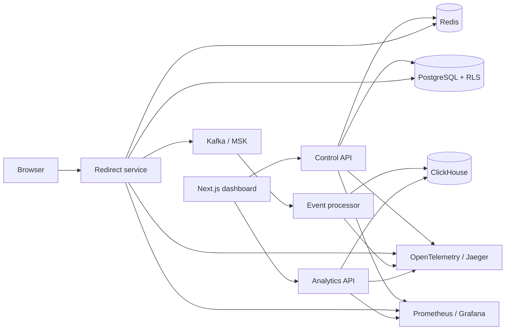

# Uzip

Uzip is a multi-tenant URL shortening and analytics platform built as four Go services. Redirects are served from Redis-backed link resolution, click events flow through Kafka, and analytical queries run against ClickHouse.

> [!NOTE]
> The AWS/EKS configuration demonstrates a production architecture. It is
> optional, is not required to run Uzip, and can cost hundreds of dollars per
> month. Use Docker Compose locally or on a single VPS for a portfolio
> deployment. See [the $100 credit guide](docs/aws-100-credit-plan.md) before
> creating AWS resources.

## Architecture



The services are:

- `control-api`: authenticated tenant-scoped link management.
- `redirect`: cache-first public alias resolution and asynchronous click publication.
- `event-processor`: enrichment, privacy filtering, retries, and dead-letter routing.
- `analytics-api`: summaries, time series, and dimensional breakdowns.

PostgreSQL row-level security is forced on tenant-owned link data. Every management query sets `app.tenant_id` inside its transaction. Redirect lookup uses a separate transaction-scoped `app.public_redirect` capability.

## Run locally

Requirements: Docker Compose, Go 1.26+, Node 22+.

```bash
docker compose up --build
```

Open:

- Dashboard: http://localhost:3000
- Control API: http://localhost:8080
- Redirect service: http://localhost:8081
- Analytics API: http://localhost:8083
- Grafana: http://localhost:3001
- Jaeger: http://localhost:16686
- Prometheus: http://localhost:9090

Local authentication uses explicit development headers. The dashboard supplies the seeded demo tenant automatically. Production disables `DEV_AUTH` and validates Cognito RS256 tokens against the pool's JWKS endpoint.

Create and exercise a link manually:

```bash
curl -X POST http://localhost:8080/api/v1/links \
  -H 'Content-Type: application/json' \
  -H 'X-User-ID: 00000000-0000-0000-0000-000000000001' \
  -H 'X-Tenant-ID: 00000000-0000-0000-0000-000000000001' \
  -H 'X-Role: owner' \
  -d '{"alias":"launch","destination":"https://example.com","redirect_type":302}'

curl -i http://localhost:8081/launch
```

## Development

```bash
make test
make vet
make build
make web-build
```

Configuration is documented in [.env.example](.env.example). API contracts are in [docs/openapi.yaml](docs/openapi.yaml), operating procedures in [docs/runbook.md](docs/runbook.md), and a k6 load test in [tests/load/redirect.js](tests/load/redirect.js).

## Deployment

For a low-cost portfolio deployment, run the Docker Compose stack on one VPS
and place Caddy, Nginx, or Cloudflare in front of it. The AWS release workflow
is manual-only and will not create or publish anything on a normal push.

Terraform under `infra/terraform` provisions:

- VPC and EKS managed node groups
- encrypted RDS PostgreSQL
- encrypted ElastiCache Redis
- MSK Serverless using IAM SASL/OAUTHBEARER
- Cognito user pool and dashboard client
- ECR repositories and an IRSA workload role

The Helm chart under `deploy/helm/uzip` deploys all four services, autoscalers, disruption budgets, ingress resources, and a persistent ClickHouse StatefulSet. Argo CD manages staging and production with automatic drift correction.

Production secrets should be synchronized from AWS Secrets Manager rather than committed to Helm values. Replace placeholder domains, repository URLs, ECR account IDs, and Cognito callback URLs before applying infrastructure.

The Terraform stack has a default cost acknowledgement lock. Do not set
`allow_expensive_stack = true` until you have reviewed the planned resources
and estimated their cost.

## Security and reliability

- Cognito JWT signature, issuer, audience, and expiration validation
- tenant-scoped repositories plus forced PostgreSQL RLS
- Redis-backed tenant and IP rate limits
- destination URL and alias validation
- hashed daily visitor identifiers; source IPs are removed before ClickHouse insertion
- non-root, read-only Kubernetes containers
- bounded ClickHouse retries and a Kafka dead-letter topic
- health probes, graceful HTTP shutdown, HPA, PDB, structured logging, metrics, and traces

The repository includes production implementations for Cognito PKCE login, dashboard deployment, ALB/ACM/Route53, External Secrets, remote-state bootstrap, migrations, MSK topic provisioning, WAF, network policies, managed-ClickHouse configuration, backup/restore drills, release automation, alerts, budgets, GeoIP, bot filtering, isolation tests, and staging load tests. Applying them still requires account-specific AWS, domain, ClickHouse, alert, and MaxMind inputs documented in [docs/production-readiness.md](docs/production-readiness.md).

## License

Released under the [MIT License](LICENSE).

## Project review and design

The dashboard serves teams managing short links and inspecting human traffic. It sends GraphQL requests to the same-origin gateway at `/api/graphql`. That gateway calls the control and analytics services internally. Public links use the redirect service, and API clients can still use the REST endpoints. Go entry points live in `cmd/`, shared packages in `internal/`, and the Next.js App Router in `web/app/`. SQL migrations initialize both stores. Terraform, Helm and GitHub workflows support optional AWS deployment.

The dashboard uses Cognito authorization code with PKCE and a Redis-backed session. The browser receives an opaque HttpOnly, SameSite cookie. HTTPS deployments set Secure on the session cookie. In local Compose or on the public demo, select **Enter demo workspace** to start a demo session. See the [gateway schema](web/app/server/graphql.ts) and [session and notification setup](docs/runbook.md#dashboard-sessions-and-notifications).
